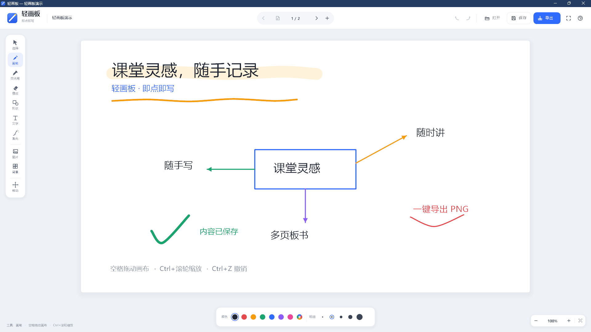

# 轻画板 v1.0

[](https://github.com/Tendo-Iya/QingHuaBan/releases/latest)
[](https://github.com/Tendo-Iya/QingHuaBan/releases)
[](https://github.com/Tendo-Iya/QingHuaBan/actions/workflows/build.yml)
[](https://github.com/Tendo-Iya/QingHuaBan/blob/main/LICENSE)

**[⬇ 下载最新版](https://github.com/Tendo-Iya/QingHuaBan/releases/latest)** —— 解压即用，无需安装。



即点即写的本地白板，原生 Windows 程序。完整自签名包首次运行一次安装脚本后，直接双击 `轻画板.exe` 即可使用，无需联网。

> **当前交付：HAVEGET工作室 自签名版**  
> 签名发布者：`CN=HAVEGET工作室, O=HAVEGET工作室`；含 DigiCert RFC3161 时间戳；安装信任证书后 `Get-AuthenticodeSignature` 为 `Valid`。  
> 自签名证书不是公共 CA 证书。微软官方说明：自签名在 SmartScreen 中与未签名等效。直接运行带下载标记的单个 EXE 仍会弹 SmartScreen；使用完整包中的 `install-and-run.cmd` 安装证书并解除下载标记后，本机 Win11 实测不再弹。  
> 首次安装会出现一次 Windows“安装 HAVEGET Studio Root CA”证书确认，无法在自签名下消除。详见 [Releases](https://github.com/Tendo-Iya/QingHuaBan/releases) 压缩包内的 `使用说明.txt`；公共受信任证书/Store 路线见 [SIGNING.md](SIGNING.md)。

## 功能

- **画笔 / 荧光笔 / 橡皮**：平滑笔迹、半透明荧光标记、整笔擦除
- **形状**：直线、箭头、矩形、椭圆，可填充
- **文字**：点击页面输入，支持拖动、缩放、编辑；底部有“完成”按钮
- **选择**：移动、四角缩放、复制、删除、置顶、置底
- **多页白板**：页面管理、缩略图、新建 / 复制 / 删除
- **纸张与底纹**：纯白 / 米黄 / 浅绿 / 浅蓝，空白 / 方格 / 横线 / 点阵
- **图片**：插入 PNG/JPG/BMP/GIF 等，拖动和缩放
- **视图**：缩放、平移、适应页面、全屏展示
- **文件**：保存 / 打开 `.qhb`，拖入 `.qhb` 或图片，导出 2400×1350 PNG
- **撤销 / 重做**：最多 40 步
- **激光笔**：按住拖动，松手渐隐

## 快捷键

| 操作 | 快捷键 |
| --- | --- |
| 选择 / 画笔 / 荧光笔 | V / P / H |
| 橡皮 / 形状 / 文字 / 激光笔 | E / R / T / L |
| 撤销 / 重做 | Ctrl+Z / Ctrl+Y |
| 保存 / 打开 / 新建 | Ctrl+S / Ctrl+O / Ctrl+N |
| 导出 PNG | Ctrl+E |
| 删除选中 / 复制选中 | Delete / Ctrl+D |
| 临时移动画布 | 空格 + 拖动 |
| 缩放 / 适应页面 | Ctrl+滚轮 / 0 |
| 全屏 / 帮助 | F11 / F1 |
| 完成文字 / 取消文字 | Ctrl+Enter / Esc |

## 构建

本项目为原生 C++（Win32 + GDI+），无 Python / .NET 运行时依赖。

需要 MinGW-w64（含 `g++`、`windres`）：

```powershell
.\build.ps1
```

产物是仓库根目录下的 `HAVEGET-Whiteboard.exe`，脚本另外复制一份到仓库的上一级目录。也可以直接运行 `build.bat`。  
签名应在构建完成后进行；再次构建会覆盖已签名文件。

## 文件

- `src/`：C++ 源码（Win32 + GDI+，纯手写，无 XAML、无框架依赖）
- `installer/`：安装器源码与资源
- `assets/`：应用图标与资源脚本
- `tools/`：图标生成、演示文件生成、自签名脚本
- `build.ps1` / `build.bat`：编译主程序
- `build_installer.ps1`：编译安装包
- `sign.ps1`：使用公共受信任证书签名并验证
- `SIGNING.md`：公共证书 / Microsoft Store 路线与证书申请资料
- `preview.png`：界面预览

编译产物（`build/`、`*.exe`）不纳入版本控制，由 `build.ps1` 生成。已编译好的安装包见 [Releases](https://github.com/Tendo-Iya/QingHuaBan/releases)。

> 自签名版不能承诺所有 Win10/11 都零提示：直接运行下载的单个 EXE 仍可能触发 SmartScreen；安装器会解除下载标记并安装信任证书，使应用本体在测试机 Win11 上不再弹。要跨任意电脑稳定零提示，仍需 Microsoft Store 或公共受信任代码签名证书。

## 相关

- [HAVEGET-DynamicIsland](https://github.com/Tendo-Iya/HAVEGET-DynamicIsland) —— Windows 顶部灵动岛，WPF 纯 C# 实现，同一作者
- 作者主页：[Tendo-Iya](https://github.com/Tendo-Iya)
